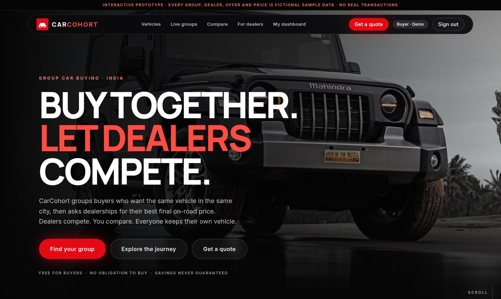
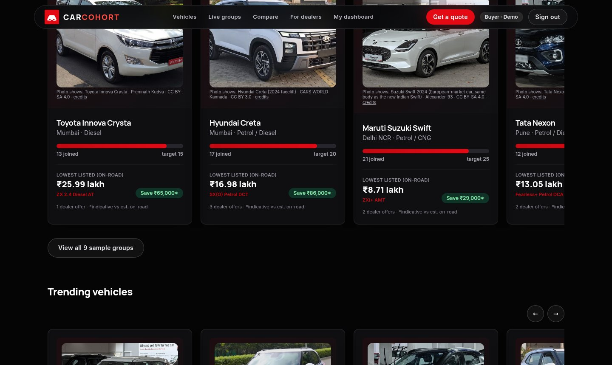
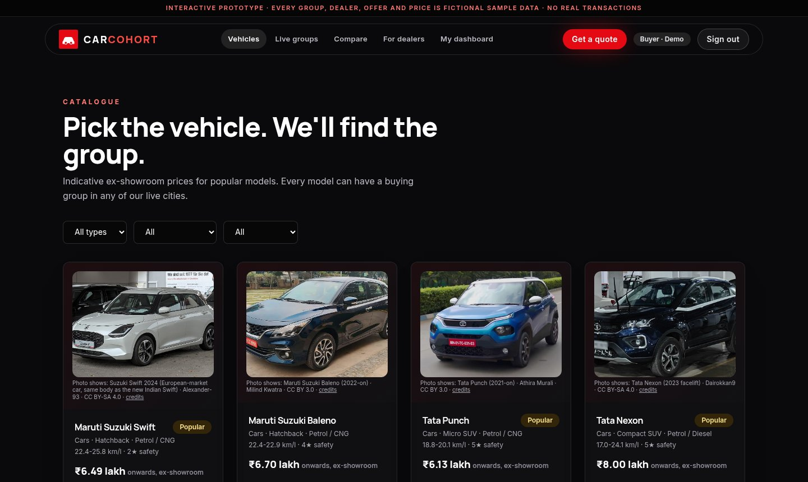
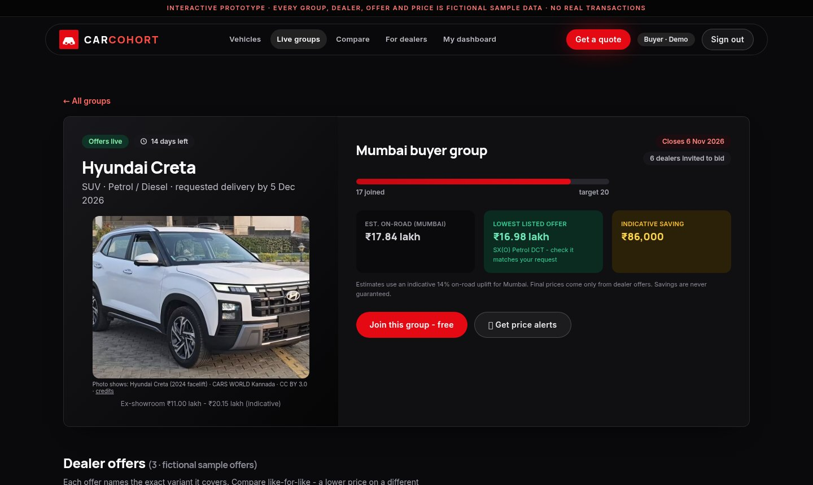
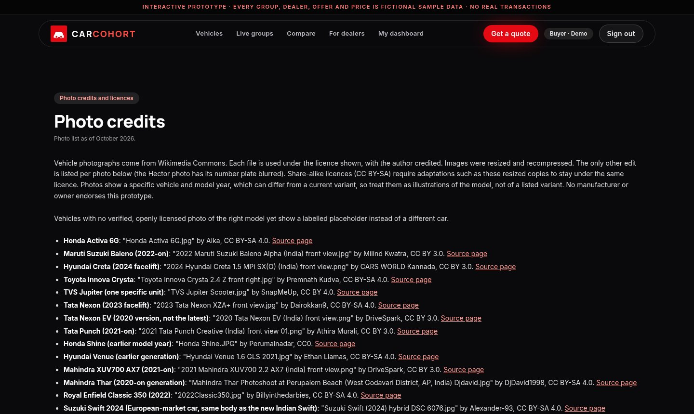
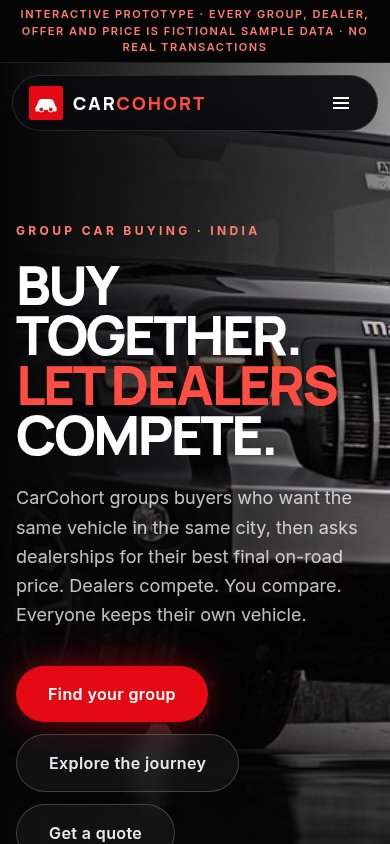
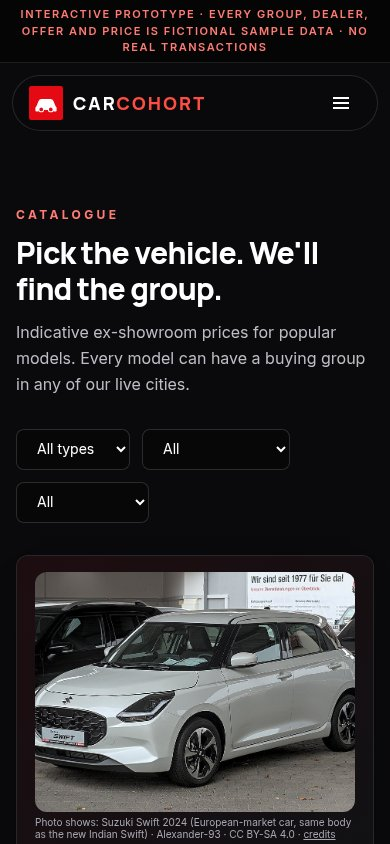

# CarCohort

**Group vehicle buying for India - interactive prototype.** One buyer has little leverage against a showroom. CarCohort explores a different approach: group buyers who want the same vehicle in the same city, ask dealerships for their best final on-road price, and show the competing offers side by side. Every buyer still owns their own vehicle.

> **Prototype notice.** Every group, dealer, offer and price in this app is fictional sample data. No dealerships are partnered, nothing is bought or sold, and savings are never guaranteed. This is not a production service and has no real authentication.

Similar group-buying ideas already exist (for example groupwe.in, groupify.co.in and ekatraonline.com). This project makes no claim to be first or unique; it is a design and engineering prototype.

## Screenshots

| | |
| --- | --- |
|  |  |
|  |  |
|  |  |

Mobile catalogue: 

Vehicle photos are real photographs from Wikimedia Commons, each with author and licence on the in-app Photo credits page and in `src/assets/photos/credits.json`. Each photo is labelled with the model, generation and market it actually shows, which can differ from a current variant. The Ather 450X has no verified openly licensed photo yet and shows a labelled placeholder.

## Features

- Cinematic dark redesign with a pinned horizontal scroll journey on desktop (GSAP ScrollTrigger) and a swipe version on touch devices, small screens and for reduced-motion users.
- Buyer quote requests: vehicle, variant, city, budget and delivery date.
- Sample live groups in Mumbai, Delhi NCR, Bengaluru, Pune and Chandigarh. Joining and leaving is free and non-binding.
- Dealer portal: dealers submit a bid with a final on-road price and inclusions; the lowest comparable offer surfaces first.
- Offers can carry an expiry date; expired offers cannot be reserved (the API returns 409).
- Side-by-side offer comparison.
- Terms, Privacy, Security and Photo credits pages. These are prototype notices written from what the code does. Operator, contact, governing-law and retention details are intentionally left undefined, not invented.

## What this is not (yet)

- No real accounts. Sign-in is a demo name picker; anyone can use any name. `?name=` filtering on the optional API only reduces what the bootstrap call returns, it is not access control. Do not enter real personal data.
- No payments, no dealer partnerships, no notifications, no price guarantee from dealers, no automatic closing of groups.
- Dealer ratings are labelled unverified samples.
- The public GitHub Pages demo is static: seed data only, state lives in your browser and resets, no backend.

## Run locally

```bash
npm ci
npm run build          # frontend into dist/
npm start              # API + built app on http://127.0.0.1:3001 (loopback only by default)

# development, two terminals
npm run server         # API on :3001
npm run dev            # Vite with /api proxy

npm test               # API tests + headless smoke walk
```

Set `HOST` to change the bind address. Do not expose the API publicly: it has no real authentication.

## Security notes

Express path: security headers and CSP, 10 kB JSON body limit, in-memory rate limits (per IP), caps on stored records, loopback bind by default. Rate limits and headers do not replace authentication. `npm audit` still reports development-server and build-time advisories (vite, esbuild, tailwind/postcss) that need major upgrades; they do not ship in the built site.

## Stack

React 18, Vite, Tailwind CSS 3, React Router (hash routing), GSAP, Node + Express with JSON-file storage in `server/`. Seed data lives in `src/data.js`.

## Photo licences

Photos are Creative Commons (CC BY, CC BY-SA, CC0) from Wikimedia Commons. CC BY-SA photos are shared under the same licence. One photo (MG Hector) has its number plate blurred. See `/credits` in the app.

## Licence

Code: MIT, see [LICENSE](LICENSE). Photos keep their own licences as listed above.
